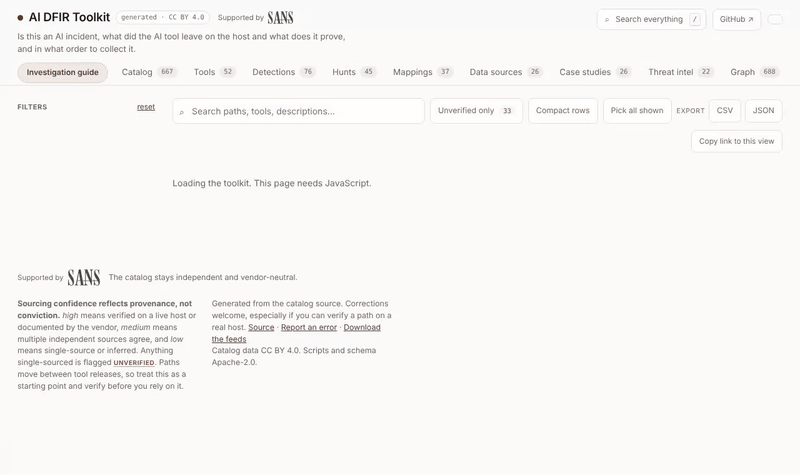
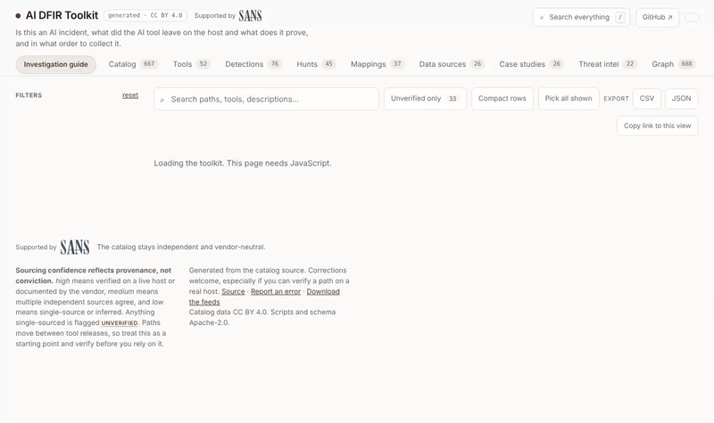

# AI DFIR Toolkit

**Detection rules, an endpoint artifact catalog and an investigation guide for incidents that involve AI.**

<a href="https://www.sans.org/"><picture>
  <source media="(prefers-color-scheme: dark)" srcset="docs/brand/sans-logo-white.svg">
  
</picture></a>

Supported by [SANS Institute](https://www.sans.org/). The project stays independent and vendor-neutral; see the disclaimer below.

Three things, built to be used together and all vendor-neutral:

- **[Detection rules](#coverage-overview)**: Sigma, YARA and Suricata rules for compromise of LLM applications, MCP servers, ML supply chains, AI infrastructure, assistants, and RAG / vector databases.
- **[Artifact catalog](#artifact-catalog)**: what AI coding agents, local model runtimes and MCP components leave on a host, what each trace proves, and the order to collect it in.
- **[Investigation guide](./docs/ai-dfir-investigation-guide.md) and [threat intel](#threat-intel)**: how to tell whether an incident involves AI at all, with case studies, actor profiles and hunts drawn from them.

**Browse it at [depalmar.github.io/ai-dfir-toolkit](https://depalmar.github.io/ai-dfir-toolkit/)** — the
artifact catalog, the detection rules, the ATLAS/OWASP mappings, the case
studies, and the investigation guide, rebuilt from this repository on every
push so the page cannot drift from the content.

### See it in use

**Start from the alert.** Name the tool the alert mentioned, say where the AI ran and what role it played, and get its traces sorted by how fast each one disappears.



**Collect in the right order.** Pick rows into a plan, group it by volatility, and export it for the collector your team already runs. Credentials are hashed, not copied.



Full-size video: [start from the alert](docs/media/start-from-the-alert.mp4) · [collection plan](docs/media/collection-plan.mp4). How they were recorded: [`docs/media/`](docs/media/README.md).

The [investigation guide](./docs/ai-dfir-investigation-guide.md) carries the attack background, the forensic artifacts, attack-chain diagrams and hands-on procedures. The latest tagged release is on the [Releases](https://github.com/depalmar/ai-dfir-toolkit/releases) page.

---

## Disclaimer

This is an independent personal project. It is not affiliated with, endorsed by, or produced on behalf of any employer. SANS Institute supports the project and has cleared its logo for use here; that support does not change the project's independence, and the content remains the maintainer's own. All research is based on public sources — published CVEs, vendor advisories, academic papers, and vendor-neutral security research. Contributions are welcome from the community.

---

## Why this exists

Most existing detection content is either locked behind vendor SIEMs or scattered across blog posts. AI/ML attacks need detection coverage that spans:

- **Endpoint** (Claude Desktop / Cursor / Copilot config tampering)
- **Cloud SaaS logs** (Bedrock, Azure OpenAI, M365 Copilot)
- **Network** (vector DB exfil, model exfil, ShadowRay C2)
- **File artifacts** (poisoned pickle models, malicious MCP configs)

The rules use **open standards only**, so they deploy in any detection stack through open Sigma, YARA and Suricata tooling.

Detection is half of it. When one of these rules fires, the responder still has to know what the tool left behind and what to collect before it is gone, which most IR playbooks do not cover. That is what the artifact catalog and the guide are for.

---

## Structure

```
ai-dfir-toolkit/
├── 01-llm-prompt-injection/      # Prompt injection, jailbreaks, indirect injection
├── 02-mcp-attacks/                # MCP tool poisoning, config tampering, rug pulls
├── 03-model-supply-chain/         # Pickle exploits, HuggingFace, dependency confusion
├── 04-ai-infrastructure/          # ShadowRay, Triton, MLflow, GPU abuse
├── 05-copilot-assistant-abuse/    # M365 Copilot, GitHub Copilot, Claude, Cursor
├── 06-rag-vector-db/              # Vector DB exposure, RAG poisoning
├── 07-runtime-ai-malware/         # Malware calling an LLM API at runtime
├── 08-agentic-orchestration/      # Agent-as-operator, AI service API as C2
├── 09-agent-memory-forensics/     # Memory as persistence, context poisoning
├── collectors/                    # Read-only acquisition with chain of custody
├── playbooks/                     # CACAO v2.0 response playbooks
├── artifacts/                     # Machine-readable AI agent artifact catalog
├── skills/                        # Agent skills for maintaining the catalog
├── docs/                          # Investigation guide, demo clips
├── tests/                         # Sample events / test files
├── MAPPINGS.md                    # ATLAS + OWASP cross-reference
└── README.md
```

Each category directory contains a `README.md` describing the threats covered and rule files in their native format (`.yml` for Sigma, `.yar` for YARA, `.rules` for Suricata).

---

## Rule formats

| Format | Use Case | Where it Deploys |
|--------|----------|------------------|
| **Sigma** (`.yml`) | Generic log-based detection | Any SIEM via [pySigma](https://github.com/SigmaHQ/pySigma) backends |
| **YARA** (`.yar`) | File / memory artifacts | EDR platforms, malware analysis, file scanning pipelines |
| **Suricata** (`.rules`) | Network traffic | Suricata, Snort (compatible subset), Zeek (via translation) |

**All rules use open formats.** No vendor-specific query languages, no proprietary field schemas. Convert to your platform using pySigma backends.

---

## Quick start

Run these from the repository root.

### Sigma, for any SIEM

```bash
pip install sigma-cli
sigma plugin list                   # find the backend for your platform
sigma plugin install NAME_FROM_THAT_LIST
sigma list targets                  # the target id that backend provides
TARGET=id_from_that_list
sigma convert -t "$TARGET" --without-pipeline 0[1-9]-*/ artifacts/detections/sigma/ > ai-dfir-rules.txt
```

`--without-pipeline` converts without mapping field names. Replace it with
`-p` and a pipeline name to map them to your data model.

Four files hold Sigma correlation rules: `mlflow_unauth_api_access.yml`,
`vector_db_bulk_exfil.yml`, `runtime_ai_malware_correlation.yml` and
`agentic_orchestration_behavior.yml`. A backend that cannot express correlation
stops on them. Convert file by file to keep the rest:

```bash
for f in 0[1-9]-*/*.yml artifacts/detections/sigma/*.yml; do
  sigma convert -t "$TARGET" --without-pipeline "$f" || echo "skipped: $f" >&2
done > ai-dfir-rules.txt
```

> **Case sensitivity:** the keyword-based rules (prompt injection, jailbreak,
> system-prompt extraction, etc.) follow the Sigma convention that `contains`
> matching is case-insensitive. Attacker text varies in case, so the rules are
> written in lowercase and rely on the backend to fold case. Check that your
> backend does. On Elasticsearch, for one, the matched fields must be mapped as
> analyzed `text` and not `keyword`: a `keyword` field matches case-sensitively
> and misses capitalized input. Do **not** try to force it with the `re|i`
> modifier there. Lucene's regex engine does not support the `(?i)` flag and
> the resulting query is invalid.

### YARA scanning

```bash
# Scan a model directory
yara -r 03-model-supply-chain/*.yar /path/to/models/

# Scan an MCP config
yara 02-mcp-attacks/mcp_tool_poisoning.yar \
  ~/Library/Application\ Support/Claude/claude_desktop_config.json
```

### Suricata

```bash
cat 0[1-9]-*/*.rules > /etc/suricata/rules/ai-dfir.rules
# Add "- ai-dfir.rules" under the existing rule-files: list in /etc/suricata/suricata.yaml
suricata -T -c /etc/suricata/suricata.yaml   # validate before reloading
systemctl reload suricata
```

---

## Artifact Catalog

[`artifacts/`](artifacts/) is a machine-readable catalog of the endpoint
artifacts left by AI coding agents, local LLM runtimes, agentic workflow
engines, and Model Context Protocol components — install paths, credential
storage, MCP configs, listening ports, process relationships, and registry keys,
each rated by forensic value and sourcing confidence, with collection priorities
for IR triage.

Eleven tool categories are covered: local LLM runtimes, coding agents and IDEs,
agent frameworks, coding-agent CLIs, workflow engines, browser agents,
computer-use agents, MCP hosts, cloud agents, code-completion tools, and
code-execution agents. Alongside them sit documented incident case studies, each
carrying its own provenance and recording analyst disagreement in a `contested`
field rather than resolving it.

Ships vendor-neutral Sigma detection rules and an osquery inventory pack, plus
generated feeds in four downstream formats:

| Export | Consumed by |
|--------|-------------|
| [ForensicArtifacts](https://github.com/ForensicArtifacts/artifacts) | Plaso, GRR, Timesketch |
| [KAPE](https://ericzimmerman.github.io/KapeDocs/) targets | KAPE triage collections |
| [Velociraptor](https://docs.velociraptor.app/) artifacts | Velociraptor hunts |
| CSV / JSON | anything else — see [`artifacts/docs/api/`](artifacts/docs/api/) |

### Threat intel

On top of the catalog sits a threat-intel layer:

<!-- intel-counts:start - generated by artifacts/scripts/readme_counts.py, do not edit -->

- **Actor profiles:** 22 profiles, covering attributed groups and
  reporter-named clusters.
- **Case studies:** 26, with 316 indicators.

<!-- intel-counts:end -->

Technique and vulnerability ids are checked against pinned releases of MITRE
ATLAS, MITRE ATT&CK, the CISA KEV catalog, and the OWASP LLM and Agentic 2026
lists. The pins are recorded in [`artifacts/schema/`](artifacts/schema/).

Each profile is derived from the cases and reported sightings that cite it. It
gives the techniques the actor uses, the rule in this repository that detects
each one, the catalogued tools the actor abused, and which of those tools'
artifacts to collect first. The site adds:
- a cross-filtering Threat intel view: ATLAS matrix with coverage gaps,
  victimology, timeline, technique heatmap, detection backlog, actor similarity
  and clusters
- a Hunts view: the rules whose own level says a match is not an alert, and the
  behaviours case studies describe in words, each with its detection logic and
  tuning notes
- a Maltego-style graph workbench
- a collection plan that generates a self-contained triage script (PowerShell or
  bash) or the equivalent Velociraptor / KAPE command

Feeds: [`intel.json`](artifacts/docs/api/intel.json), a
[STIX 2.1 bundle](artifacts/docs/api/stix/ai-dfir-intel.json) for OpenCTI or
MISP, and [Maltego import CSVs](artifacts/docs/api/graph/). Two scheduled
workflows keep it current:
- the framework pins are refreshed weekly and opened as a pull request for a
  person to check and merge
- new public reporting arrives as `intel-candidate` issues for a person to
  research

For current counts — catalogued tools, documented artifacts, credential
locations, MCP config paths, case studies, and the risk and confidence
breakdowns — see the Contents table in [`artifacts/README.md`](artifacts/README.md).
That table is generated by `scripts/readme_counts.py` and gated in CI, so it is
the one place those numbers are guaranteed current.

---

## Coverage overview

76 rule files containing 171 individual signatures — nine attack-class categories
plus a cross-tool endpoint set:

| Category | Files | Signatures | ATLAS Techniques | OWASP LLM 2026 | OWASP Agentic |
|----------|-------|-----------:|------------------|-----------|---------------|
| LLM Prompt Injection | 8 | 10 | T0051, T0054, T0029 | LLM01, LLM02, LLM06, LLM08 | ASI01 |
| MCP Attacks | 5 | 14 | T0010, T0115.002, T0110, T0086 | LLM02, LLM03, LLM04 | ASI02, ASI03, ASI04, ASI05 |
| Model Supply Chain | 8 | 25 | T0010, T0011, T0018, T0086 | LLM04 | ASI03, ASI04, ASI05 |
| AI Infrastructure | 9 | 31 | T0011, T0049, T0029 | LLM06 | — |
| Copilot/Assistant Abuse | 8 | 19 | T0086, T0024 | LLM02, LLM03, LLM04 | ASI01, ASI02, ASI03, ASI04, ASI05 |
| RAG / Vector DB | 5 | 19 | T0070, T0024, T0051, T0011 | LLM01, LLM02, LLM09 | ASI01, ASI06 |
| Runtime AI-Malware | 8 | 16 | T0096, T0086 | LLM01, LLM03 | — |
| Agentic Orchestration & AI-Service C2 | 8 | 17 | T0096, T0086, T0054, T0012, T0055, T0116 | LLM03 | ASI02 |
| Agent Memory & Context Poisoning | 2 | 5 | T0080, T0080.000, T0086 | LLM01, LLM02, LLM03 | ASI06 |
| Endpoint (cross-tool) | 15 | 15 | T0053, T0081, T0083, T0098, T0010.001 | LLM02, LLM03, LLM04, LLM06 | ASI02, ASI03, ASI04, ASI05 |
| **Total** | **76** | **171** | | | |

The endpoint set lives in [`artifacts/detections/`](artifacts/detections/) and is
scoped to agent behaviour on a host rather than to one attack class, so it applies
across every tool in the artifact catalog. An osquery pack there answers the
inventory question ("which hosts have this") that the Sigma rules cannot.

*Signature count includes multi-document Sigma YAML, multiple `rule` blocks inside a single YARA file, and multiple `alert` lines inside a single Suricata `.rules` file, except one `flowbits:noalert` helper that only sets state for the rule after it. One file often covers several related variants.*

See [MAPPINGS.md](./MAPPINGS.md) for per-rule mappings.

---

## Tuning notes

These rules are written to err toward signal over noise, but every environment is different. Each rule includes:

- `falsepositives:` section listing known FP scenarios
- `level:` field (`low` / `medium` / `high` / `critical`) — start with `high`+ in production. A `low` rule is a hunt, not an alert: baseline it first. The site's Hunts view lists them
- Tunable selectors so you can scope to specific orgs/users/namespaces

Recommended rollout:
1. Deploy to a test index/workspace for 7 days
2. Triage hits, tune `selection` and `filter` blocks
3. Promote to production with appropriate severity

---

## Testing

The `tests/` directory contains sample artifacts (malicious and benign) for validating rule correctness. Run:

```bash
cd tests/
./validate.sh
```

Expected result: every line reads `PASS` and the summary ends with `FAIL: 0`.

The suite hard-exits if the `yara` binary is missing rather than reporting a
clean run — absent tooling would otherwise score every "expect no matches"
assertion as a pass and the suite would look healthy while testing nothing.

What is and is not tested:

- **YARA** rules are run against malicious and benign fixtures by `validate.sh`.
- **Suricata** rules are syntax-checked, and `python3 tests/suricata_replay.py`
  replays synthetic traffic through the rules that depend on direction or ports.
- **Sigma** rules are parsed and converted in CI. They are not replayed against
  recorded events, so treat a Sigma rule as untested on your data until you
  have run it there.

---

## Contributing

PRs welcome. [CONTRIBUTING.md](./CONTRIBUTING.md) has the full rules for
detections, catalog entries and case studies. For a rule, in short:

1. Reference an attack technique — ATLAS ID, CVE, or published research
2. Include test data in `tests/` — sample log line, file, or PCAP
3. Document false positives in the rule
4. Use lowercase, snake_case filenames matching the threat
5. Tag with `attack.atlas.txxxx` in Sigma rules

Sigma format: follow the [Sigma specification](https://github.com/SigmaHQ/sigma-specification).

---

## References

- [MITRE ATLAS](https://atlas.mitre.org/)
- [OWASP Top 10 for LLM Applications 2026](https://genai.owasp.org/llm-top-10/) — detection content maps to the **2026** list; eight of the ten IDs changed meaning from 2025, so an ID quoted from an older report names a different category here
- [NIST AI RMF](https://www.nist.gov/itl/ai-risk-management-framework)
- [Sigma HQ](https://github.com/SigmaHQ/sigma)
- [AI Incident Database](https://incidentdatabase.ai/)

---

## License

Apache License 2.0 — see [LICENSE](./LICENSE).

You are free to use, modify, and redistribute these rules in commercial and non-commercial settings. Attribution appreciated but not required.

Catalog data under `artifacts/catalog/`, `artifacts/case-studies/`, and
`artifacts/docs/api/` is licensed CC BY 4.0; see
[`artifacts/LICENSE-DATA`](./artifacts/LICENSE-DATA). All other content,
including the scripts and schema under `artifacts/`, is under the repository's
Apache-2.0 licence.

---

**Maintainer:** Raymond DePalma — independent security researcher.
This is a personal project and is not affiliated with any employer. SANS Institute's support is described in the [disclaimer](#disclaimer).
